# hrb_common_libs

Shared connector + observability library for the HRB chatbot microservices split. Not a deployed service - no running instance exists anywhere, no "current state"/"target state"/"deployment" diagrams apply the way they do for the other 6 repos.

## For reviewers / new team members (5 minutes)

1. [Consumption architecture](../docs/architecture/diagrams/hrb-common-libs-consumption-architecture.drawio) - who depends on this and why a git-tag pin, not a floating branch or 10+ separate PyPI packages.
2. The extras table below - what each consumer actually installs.
3. `ROADMAP.md` - all 17 build phases, if you want the full history.

## Install (as a consumer, not for local dev of this repo itself)

```bash
pip install "git+https://github.com/rvsree/hrb_common_libs.git@v0.4.0#egg=hrb_common_libs[db,cache]"
```

## Tech Stack

```mermaid
flowchart TD
    HUB((hrb_common_libs))
    HUB --> OBS[Observability]
    HUB --> DB[Database]
    HUB --> VDB[Vector Store]
    HUB --> CACHE[Cache]
    HUB --> LLM[LLM]
    HUB --> MCP[MCP]
    HUB --> STORE[Storage]
    HUB --> WEB[Web]
    HUB --> AUTH[Auth]
    HUB --> EMAIL[Email]
    HUB --> CI[CI]

    OBS --> O1[structlog]
    OBS --> O2[tenacity]
    DB --> D1[psycopg]
    VDB --> V1[ChromaDB]
    VDB --> V2[Pinecone]
    VDB --> V3[langchain-chroma]
    CACHE --> C1[redis]
    LLM --> L1[OpenAI]
    LLM --> L2[Anthropic]
    LLM --> L3[langchain-openai]
    MCP --> M1[mcp]
    MCP --> M2[pydantic]
    STORE --> S1[boto3]
    WEB --> W1[tavily-python]
    AUTH --> A1[httpx]
    AUTH --> A2[pyjwt]
    EMAIL --> E1[boto3]
    CI --> CI1[PyGithub]

    classDef hub fill:#4C1D95,color:#fff,stroke:#2E1065,stroke-width:2px
    classDef obs fill:#1D4ED8,color:#fff,stroke:#1E3A8A
    classDef db fill:#047857,color:#fff,stroke:#064E3B
    classDef vdb fill:#B45309,color:#fff,stroke:#78350F
    classDef cache fill:#DC2626,color:#fff,stroke:#7F1D1D
    classDef llm fill:#BE185D,color:#fff,stroke:#831843
    classDef mcp fill:#7C3AED,color:#fff,stroke:#4C1D95
    classDef store fill:#0D9488,color:#fff,stroke:#134E4A
    classDef web fill:#CA8A04,color:#fff,stroke:#713F12
    classDef auth fill:#475569,color:#fff,stroke:#1E293B
    classDef email fill:#2563EB,color:#fff,stroke:#1E3A8A
    classDef ci fill:#9333EA,color:#fff,stroke:#581C87
    class HUB hub
    class OBS,O1,O2 obs
    class DB,D1 db
    class VDB,V1,V2,V3 vdb
    class CACHE,C1 cache
    class LLM,L1,L2,L3 llm
    class MCP,M1,M2 mcp
    class STORE,S1 store
    class WEB,W1 web
    class AUTH,A1,A2 auth
    class EMAIL,E1 email
    class CI,CI1 ci
```



## Tech stack / extras

**Correction, 2026-10-24: 11 real extras, not 10.** This README previously listed 10 and omitted `vectorstore` - verified directly against `pyproject.toml`'s own `[project.optional-dependencies]` table:

| Extra | Pulls in |
|---|---|
| `observability` | `structlog`, `tenacity`, `boto3` |
| `db` | `psycopg[binary]` |
| `vectorstore` | `chromadb`, `pinecone`, `langchain-pinecone`, `langchain-chroma`, `langchain-openai` |
| `cache` | `redis` |
| `llm` | `openai`, `langchain-openai`, `anthropic`, `boto3` |
| `mcp` | `mcp`, `pydantic` (version-pinned to avoid a real conflict found in Phase 5) |
| `storage` | `boto3` |
| `web` | `tavily-python` |
| `auth` | `httpx`, `pyjwt` |
| `email` | `boto3` |
| `ci` | `PyGithub` |

(`dev` is a 12th group - `pytest`/`pytest-asyncio`/`respx`, test-only, not a product extra.) Every extra implicitly pulls in `observability` too - every consumer gets structured logging and Secrets Manager access regardless of which extras it picks.

## Status, 2026-10-23: all 17 phases built, tagged v0.4.0, in real production use

Used by every other repo in this split (`hrb_api_gateway_service`, `hrb_platform_components`, `hrb_rag_ingestion_service`, `hrb_rag_retrieval_service`) - one git-tag-pinned version for everyone, never a floating dependency. Confirmed live: `Secrets Manager + request_id middleware` (Phase 17) is in active use by `hrb_rag_ingestion_service`'s own Lambda, confirmed working in production.

## Documentation index

| Doc | What it covers |
|---|---|
| [Overview / Spec / Architecture / Design / Decisions](../docs/platform-and-admin/common-libs-connectors/) | The full HTML doc set |
| [Build + publish process](../docs/deployment-and-ops/build-and-deploy/07-hrb-common-libs-build-and-publish.html) | Git-tag release model, step-by-step - no Docker, no App Runner, deliberately |
| [`platform-overview.html`](../docs/architecture/platform-overview.html) | The cross-service hub - business capabilities, all 7 repos, one diagram |

Older paths under `docs/dev-reference/common-libs-connectors/` (no `hrb_chatbot_v3/` prefix) referenced in earlier commits are stale - that folder was reorganized 2026-10-23, and the links above reflect the current location.
